<p align="center">
  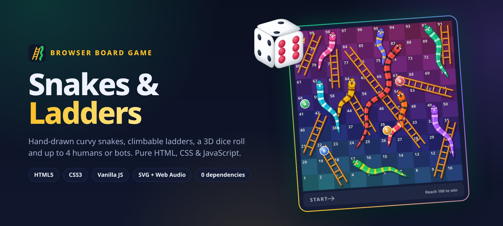
</p>

<h1 align="center">🐍 Snakes &amp; Ladders 🪜</h1>

<p align="center">
  <b>The classic board game, rebuilt from scratch for the browser.</b><br>
  Curvy hand-drawn snakes, climbable ladders, a tumbling 3D die, 2 to 4 humans or bots,<br>
  synthesized sound effects, save and resume, and dark and light themes.<br>
  Plain HTML, CSS and JavaScript. No frameworks, no libraries, no images, no build step.
</p>

<p align="center">
  
  
  
  
  
  
  
</p>

<p align="center">
  <a href="https://rishabh-bgp.github.io/snakes-and-ladders/"><b>🎲 Play it live</b></a> ·
  <a href="#how-to-play">How to play</a> ·
  <a href="#run-it-locally">Run locally</a>
</p>

---

## Why this exists

Snakes and Ladders is simple to play but surprisingly fiddly to build well: a zig-zag board, jumps that have to *look* like climbing and sliding, several tokens on one square, bots, house rules and a game you can close and resume. This project does all of that with nothing but the web platform. Every snake, ladder, token and die face is drawn in code with SVG and CSS, and every sound is synthesized live with the Web Audio API.

## Features

| | Feature | Details |
|---|---|---|
| 🎲 | **3D dice roll** | A real CSS 3D cube that tumbles and lands on the rolled face. Roll by clicking, tapping, <kbd>Space</kbd> or <kbd>Enter</kbd>. Fair rolls from `crypto.getRandomValues` |
| 🐍 | **Hand-drawn snakes** | Tapered, wiggly bodies built from a sine-wave spine, with stripes, a sheen, googly eyes and a flicking tongue. Ten colour schemes |
| 🪜 | **Ladders you can climb** | Wooden rails and rungs drawn from the two squares they connect |
| 🏃 | **Animated tokens** | Tokens hop square by square, **climb ladders** and **slide down the curvy body of the snake**, then settle neatly when several share a square |
| 👥 | **2 to 4 players** | Each player can be a **human or a bot**, with their own name and colour. Pass-and-play on one device |
| 🤖 | **Bots** | Bots take their turns automatically, so you can play solo or watch an all-bot game |
| ⚙️ | **House rules** | Exact roll to finish, a 6 gives an extra roll, and three 6s in a row forfeit the turn. Each one is a toggle |
| 📜 | **Turn indicator and move log** | Big turn card with the current player's colour, progress bars, ladder and snake counters, and a full log of every move |
| 🏆 | **Win screen** | Trophy, canvas confetti, final standings table, **Play again** or **Change players** |
| 🔊 | **Sound effects** | Dice rattle, hops, a rising ladder arpeggio, a sliding snake hiss and a win fanfare, all synthesized with the Web Audio API. Mute toggle remembered |
| 💾 | **Save and resume** | The game is saved to `localStorage` after every move. Close the tab and resume later |
| 🌗 | **Dark and light themes** | Follows your system on first visit, remembered after that, with no flash on load |
| 📱 | **Responsive** | Plays great on a 390 px phone and on desktop, with large touch targets |
| ♿ | **Accessible** | Full keyboard control, `aria-live` announcements of every move, labelled controls, visible focus and AA contrast. Honours `prefers-reduced-motion` |
| 🔁 | **Replayable dice** | Add `?seed=42` to the URL to replay the same dice sequence, handy for testing and demos |

## Screenshots

<table>
  <tr>
    <td width="50%">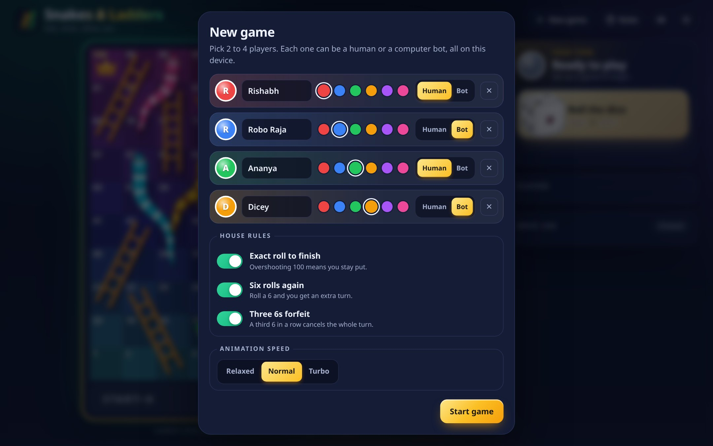<p align="center"><sub><b>Setup:</b> names, colours, human or bot, house rules</sub></p></td>
    <td width="50%">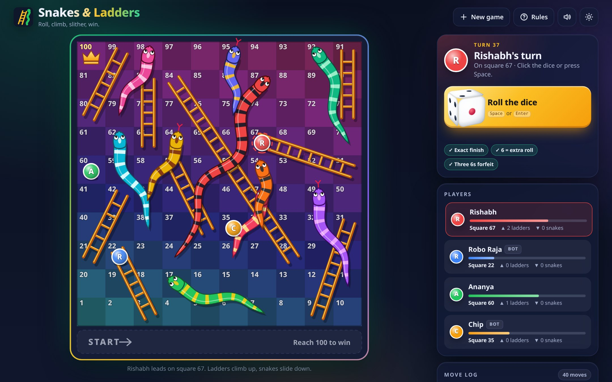<p align="center"><sub><b>Mid-game</b> with four players, dark theme</sub></p></td>
  </tr>
  <tr>
    <td width="50%">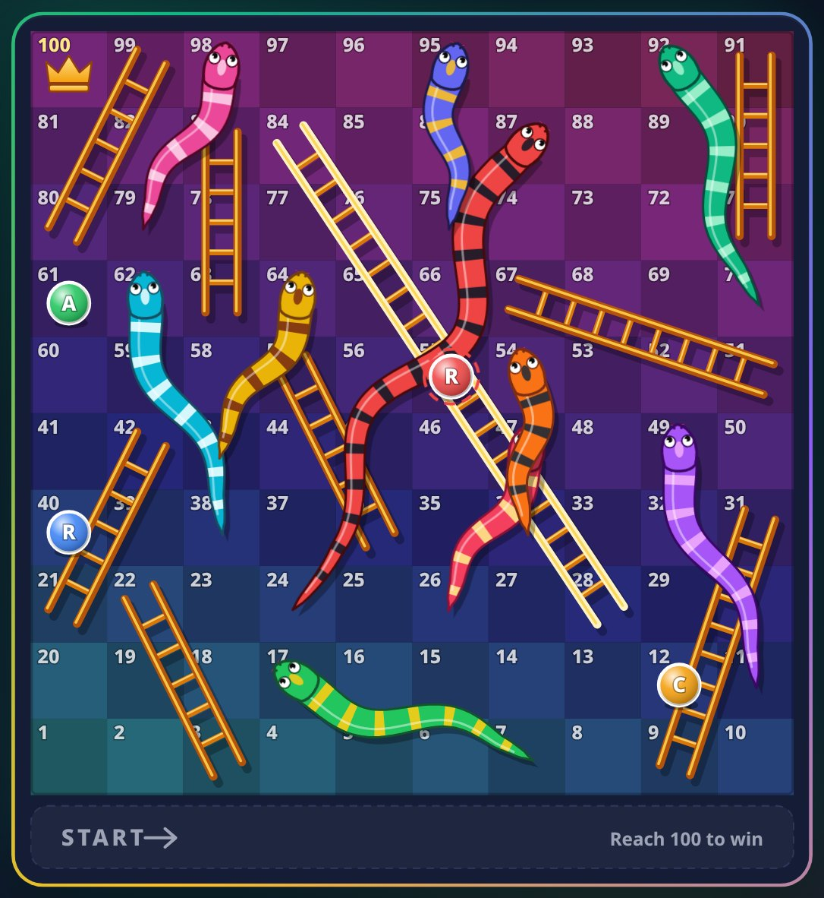<p align="center"><sub><b>Ladder climb</b>, captured mid-animation (28 → 84)</sub></p></td>
    <td width="50%">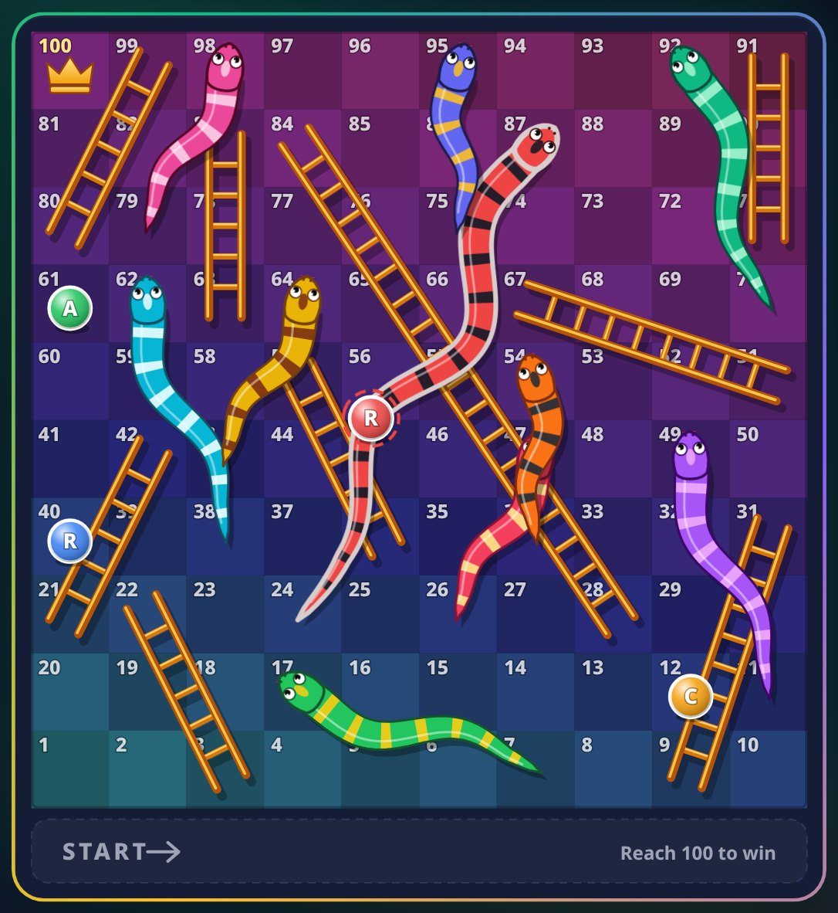<p align="center"><sub><b>Snake slide</b> along the curvy body, captured mid-animation (87 → 24)</sub></p></td>
  </tr>
  <tr>
    <td width="50%">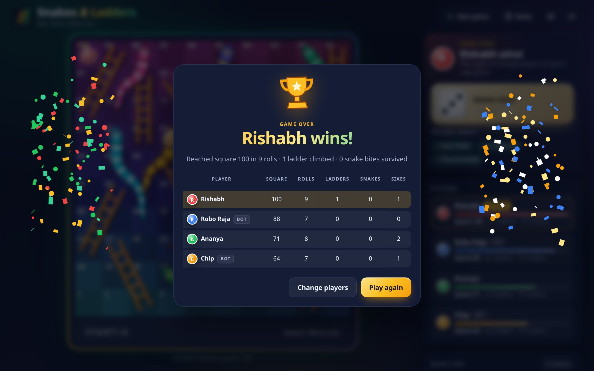<p align="center"><sub><b>Win screen</b> with confetti and final standings</sub></p></td>
    <td width="50%">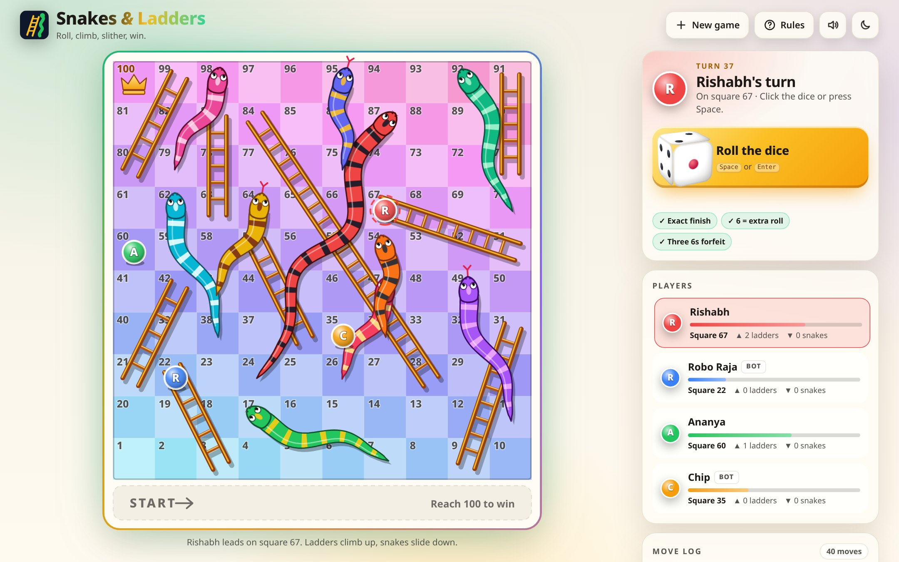<p align="center"><sub><b>Light theme</b></sub></p></td>
  </tr>
  <tr>
    <td width="50%" colspan="2">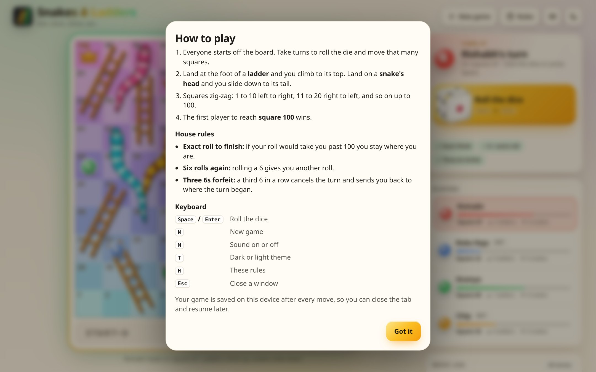<p align="center"><sub><b>Built-in rules</b> and keyboard shortcuts</sub></p></td>
  </tr>
</table>

### On a phone

<p align="center">
  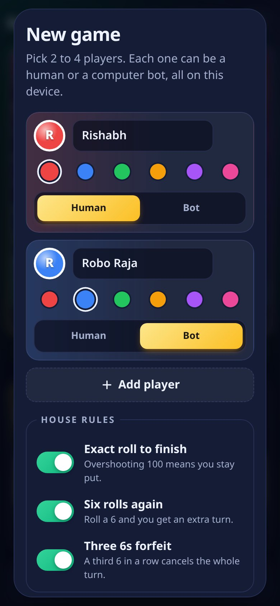
  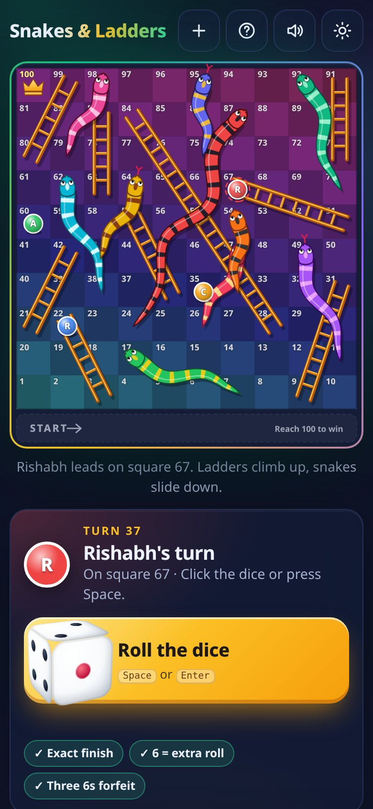
  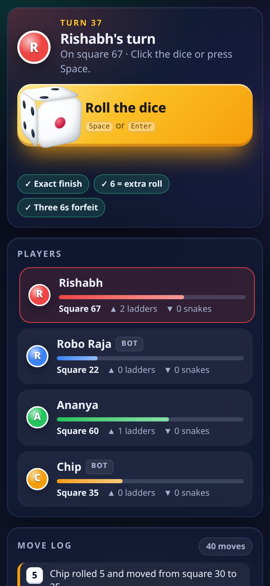
  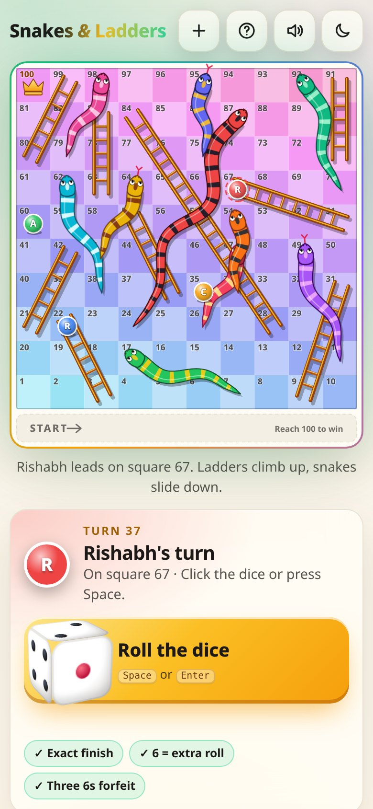
  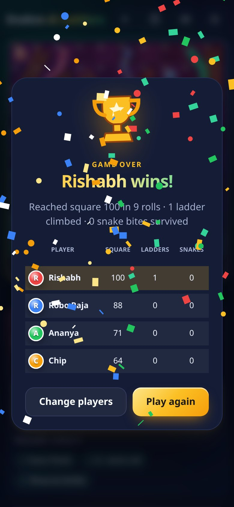
</p>

## How to play

1. Click **New game**, add 2 to 4 players, and pick a name, colour and **Human** or **Bot** for each.
2. On your turn, roll the die (click or tap it, or press <kbd>Space</kbd> / <kbd>Enter</kbd>). Your token hops forward that many squares.
3. The board zig-zags: 1 to 10 runs left to right, 11 to 20 right to left, and so on up to 100.
4. Land at the **foot of a ladder** and you climb to the top. Land on a **snake's head** and you slide down to its tail.
5. The first player to reach **square 100** wins.

### Rules and options

| Option | Default | What it does |
|---|---|---|
| **Exact roll to finish** | On | If your roll would take you past 100, you stay where you are. Turn it off and any roll that reaches 100 wins |
| **Six rolls again** | On | Rolling a 6 gives you another roll straight away |
| **Three 6s forfeit** | On | A third 6 in a row cancels the whole turn and puts your token back where the turn began. Only available when *Six rolls again* is on |
| **Animation speed** | Normal | Relaxed, Normal or Turbo. Turbo is great for bot battles |

### The board

All snakes and ladders live in **one config object** in [`assets/js/config.js`](assets/js/config.js). Change a number and the board redraws itself. The layout is checked on start, so a ladder that goes down or a jump that chains into another is rejected.

| 🪜 Ladders | 🐍 Snakes |
|---|---|
| 3 → 22 · 9 → 31 · 21 → 42 · **28 → 84** · 36 → 57 · 51 → 67 · 63 → 83 · 71 → 91 · 80 → 99 | 17 → 7 · 47 → 26 · 49 → 11 · 54 → 34 · 62 → 38 · 64 → 43 · **87 → 24** · 92 → 70 · 95 → 75 · 98 → 79 |

Nine ladders and ten snakes, with the long ladder in the lower half and the nastiest snakes near the top, like a classic board. Across 3,000 simulated two-player games the median game lasts about 25 rolls per player.

## Keyboard controls

| Key | Action |
|---|---|
| <kbd>Space</kbd> / <kbd>Enter</kbd> | Roll the dice |
| <kbd>N</kbd> | New game |
| <kbd>M</kbd> | Sound on or off |
| <kbd>T</kbd> | Dark or light theme |
| <kbd>H</kbd> or <kbd>?</kbd> | How to play |
| <kbd>Esc</kbd> | Close a dialog |
| <kbd>Tab</kbd> | Move between controls (a skip link jumps straight to the dice) |

## Run it locally

No installation and no build step.

**Option 1:** download the repo and double-click `index.html`.

**Option 2:** run any static server:

```bash
git clone https://github.com/Rishabh-bgp/snakes-and-ladders.git
cd snakes-and-ladders
python3 -m http.server 8000
# open http://localhost:8000
```

**Run the unit tests** (Node 18 or newer, no packages needed):

```bash
node --test tests/
```

## Quality checks

- **19 unit tests** for the game engine (`tests/engine.test.js`, Node's built-in test runner):
  - board coordinates: the boustrophedon mapping, all 100 squares unique and adjacent
  - every ladder and snake in the config, and the board validator
  - exact finish on and off, the extra roll on a 6, and the triple-6 forfeit
  - bot turns, plus **300 complete auto-played games** that always end with a winner on 100
  - dice fairness over 60,000 rolls
  - save and resume round-trips
- **115 browser checks** with Playwright and headless Chrome:
  - setup, game and win screens at **1366 px and 390 px**, in dark and light, with **no console errors, no failed requests and no horizontal overflow**
  - **axe-core** WCAG 2.1 AA audits on every screen
  - keyboard controls, `aria-live` announcements, bots taking their turns, and tokens following the ladder and the curvy snake while animating
  - neat offsets for four tokens on one square
  - a full **all-bot game played in the UI** to the win screen, confetti, and Play again
  - the house rules in the UI, save and resume after a reload, and reduced motion
- **html-validate** (recommended rules) passes.
- **Zero external requests**: no fonts, scripts or images from anywhere else.

## Lighthouse

Measured with Lighthouse 12.8 (headless Chrome, default simulated throttling).

| Run | Performance | Accessibility | Best practices | SEO | LCP |
|---|---|---|---|---|---|
| Desktop | **100** | **100** | **100** | **100** | 0.4 s |
| Mobile | **99** | **100** | **100** | **100** | 1.6 s |

Cumulative layout shift is 0.

## Folder structure

```
snakes-and-ladders/
├── index.html             # the whole app: board, side panel, setup, win and rules dialogs
├── assets/
│   ├── css/styles.css     # design tokens, both themes, board styling, 3D die, layout, motion
│   ├── js/config.js       # ONE object with every snake and ladder (edit to make your own board)
│   ├── js/engine.js       # pure game rules: coordinates, moves, jumps, house rules, bots, save format
│   ├── js/board.js        # SVG renderer: squares, curvy snakes, ladders, start dock, tokens
│   ├── js/audio.js        # Web Audio sound effects (dice, hop, ladder, snake, win)
│   ├── js/app.js          # UI: setup, dice, animations, turns, log, announcements, win, save
│   ├── js/theme-init.js   # applies the saved theme before first paint
│   └── img/favicon.svg
├── tests/engine.test.js   # unit tests (node --test tests/)
├── screenshots/           # README images
├── .nojekyll
├── LICENSE
└── README.md
```

## How it works

- **Board maths.** Square *n* sits on row `⌊(n − 1) / 10⌋`; even rows run left to right and odd rows run right to left. `engine.js` turns that into SVG coordinates on a 1000 × 1000 grid.
- **Snakes.** Each snake starts as a straight line from head to tail. A sine wave is added along it, the body is widened into a tapering outline using the normal at each point, then the stripes, sheen and head are layered on top. The same spine is the path a token slides along.
- **Animation.** A tiny `requestAnimationFrame` tween engine moves tokens with easing: an arc for each hop, an even climb up the ladder and a slide along the snake's spine.
- **Engine and UI are separate.** `engine.js` never touches the DOM. It takes a state and a roll and returns a new state plus a description of what happened, which the UI then animates. That is why the rules can be unit tested in Node.
- **Sound.** Oscillators, filtered noise bursts and pitch ramps. The audio context starts on your first click, as browsers require.

## What I learned

- Turning a game's rules into a pure, testable state machine
- Procedural SVG drawing: offset curves, tapering shapes and path following
- CSS 3D transforms and keeping animations smooth with `requestAnimationFrame`
- Synthesizing sound effects from scratch with the Web Audio API
- Accessibility for a visual game: live regions, keyboard play and reduced motion
- Testing a browser game end to end with Playwright

## Author

**Rishabh Aryan** · [@Rishabh-bgp](https://github.com/Rishabh-bgp)

## License

Released under the [MIT License](LICENSE). © 2026 Rishabh Aryan
